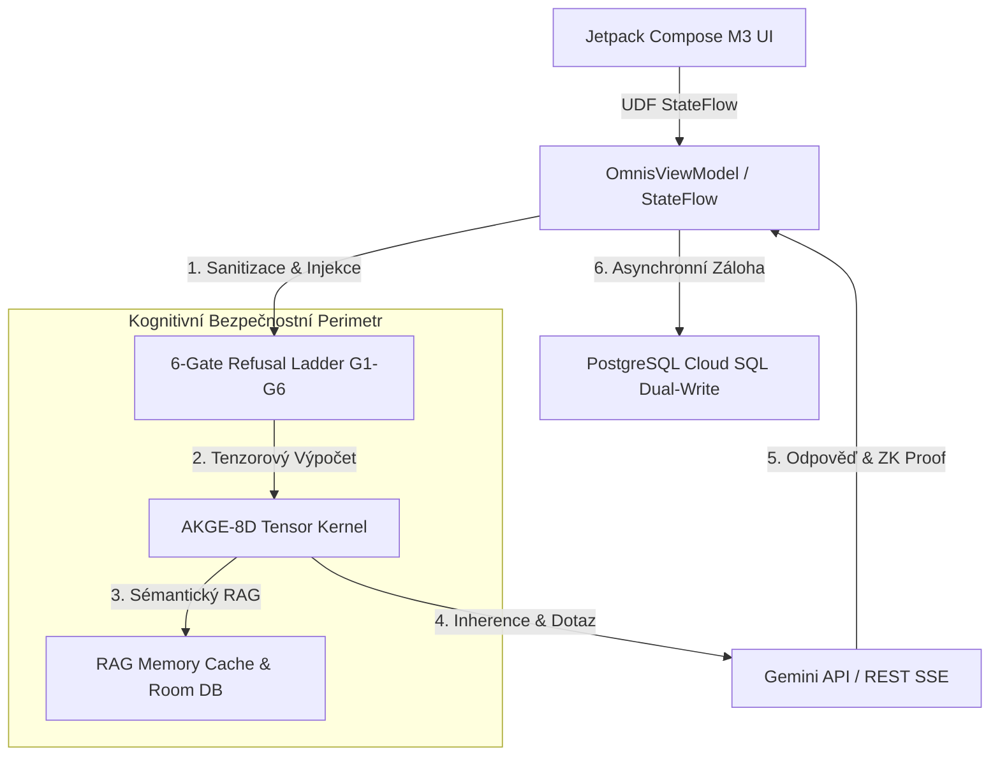
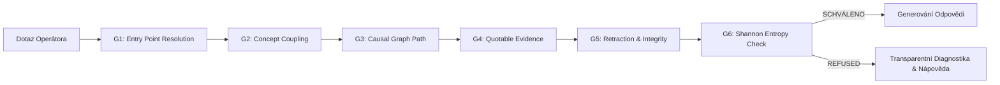
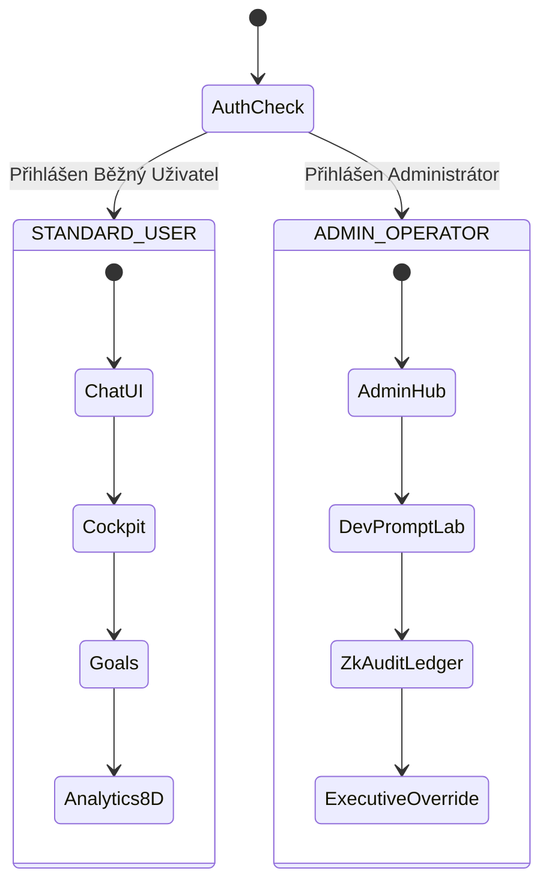

# O.M.N.I.S. (Agentic Knowledge Graph & Invariant Inference Engine — AKGE-8D)

**O.M.N.I.S.** (v4.2 Production Ready) je špičková transdisciplinární kognitivní architektura a analytická platforma pro Android (Kotlin 2.0 & Jetpack Compose Material 3) integrovaná s Python FastAPI backendem, Compressed Sparse Row (CSR) znalostními grafy a 8D tenzorovou logikou.

---

## 🏗️ 1. Celková Architektura Systému



### ASCII Blokové Schéma Architektury Vrstev

```
┌─────────────────────────────────────────────────────────────────────────────────┐
│                      PREZENTAČNÍ VRSTVA (Jetpack Compose M3)                    │
│  ┌──────────────────────────────────┐        ┌───────────────────────────────┐  │
│  │   STANDARD_USER Layout           │        │   ADMIN_OPERATOR Layout       │  │
│  │   (Kognitivní Chat, Kokpit, Cíle)│        │   (Admin Hub, Dev Prompt Lab) │  │
│  └─────────────────┬────────────────┘        └───────────────┬───────────────┘  │
└────────────────────┼─────────────────────────────────────────┼──────────────────┘
                     │                                         │
                     ▼                                         ▼
┌─────────────────────────────────────────────────────────────────────────────────┐
│                       KOGNITIVNÍ A AUDITNÍ RÁMEC (AKGE-8D)                      │
│  ┌──────────────────────┐  ┌──────────────────────┐  ┌────────────────────────┐ │
│  │ Refusal Ladder G1-G6 │  │ 8D Tensor Kernel     │  │ ZK Audit Ledger        │ │
│  │ (Zero-Hallucination) │  │ (Harmonická matice)  │  │ (SHA-256 Commitments)  │ │
│  └──────────────────────┘  └──────────────────────┘  └────────────────────────┘ │
└────────────────────┬────────────────────────────────────────────────────────────┘
                     │
                     ▼
┌─────────────────────────────────────────────────────────────────────────────────┐
│                     PERSISTENCE & CLOUD SYNCHRONIZACE                           │
│  ┌──────────────────────────────────┐        ┌───────────────────────────────┐  │
│  │ Room Database v12 (SQLite)       │ ─────► │ Cloud SQL PostgreSQL          │  │
│  │ (Offline-First Šifrovaná Paměť)  │        │ (pgvector Dual-Write Replikace)│  │
│  └──────────────────────────────────┘        └───────────────────────────────┘  │
└─────────────────────────────────────────────────────────────────────────────────┘
```

---

## 🌟 2. Klíčové Schopnosti a 8D Tenzorové Jádro

### 🧩 8D Funkční Matice a 28-Párový Tenzor Vazeb
Každý kognitivní podnět i systémový stav je deterministicky hodnocen napříč 8 fundamentálními dimenzemi:
$$\vec{V} = [\text{SYS}, \text{ECON}, \text{PSYCH}, \text{ECO}, \text{LAW}, \text{SEC}, \text{PHYS}, \text{SOC}]$$

```
                  ┌───────────────────────────────┐
                  │    8D RADAROVÁ DIAGNOSTIKA    │
                  └───────────────┬───────────────┘
                                  │
                                 SYS
                                  │
                       SOC ───────┼─────── ECON
                             ╲    │    ╱
                              ╲   │   ╱
                     PHYS ─────    ┼    ───── PSYCH
                              ╱   │   ╲
                             ╱    │    ╲
                       SEC ───────┼─────── ECO
                                  │
                                 LAW
```

- **SYS (Systemic)**: Architektonická provázanost, modularita a determinismus závislostí.
- **ECON (Economic)**: Nákladová efektivita, tokenový rozpočet a návratnost investic (ROI).
- **PSYCH (Psychological)**: Kognitivní zátěž, mentální ergonomie a psychologické bezpečí.
- **ECO (Ecological)**: Energetická stopa, chlazení a dlouhodobá udržitelnost zdrojů.
- **LAW (Legal)**: Regulatorní soulad (EU AI Act, GDPR, NIS2, ISO/IEC 42001).
- **SEC (Security)**: Zero-Trust perimetr, kryptografická ochrana a ochrana integrity.
- **PHYS (Physical)**: Hardwarová infrastruktura, Edge telemetrie a propustnost.
- **SOC (Societal)**: Společenský dopad, týmová koheze a etická odpovědnost.

Všech $\binom{8}{2} = 28$ interakcí mezi doménami je kvantifikováno empirickým korelačním tenzorem $r \in [-1.0, +1.0]$, identifikujícím kritické frikce i synergie.

---

## 🛡️ 3. 6-Úrovňový Refusal Ladder Gatekeeper (Zero-Hallucination)

Každý dotaz i odpověď v systému O.M.N.I.S. povinně prochází 6 rigorózními verifikačními branami:



1. **G1 (Entry Point Resolution)**: Identifikace a mapování vstupních uzlů v 8D ontologii.
2. **G2 (Concept Coupling)**: Provázání minimálně 2 konceptů nebo verifikace sémantického kontextu.
3. **G3 (Causal Graph Path)**: Ověření existence souvislé kauzální cesty v CSR (`CsrKnowledgeGraph`) grafu pomocí Judea Pearl Do-Calculus $P(Y \mid do(X=x))$.
4. **G4 (Quotable Evidence)**: Důkazní ukotvení vůči mezinárodním normám a normativním standardům (ISO/IEC, IEEE, NIST SP 800-207, EU AI Act, NIS2).
5. **G5 (Retraction & Integrity)**: Ochrana před zastaralými, falzifikovanými nebo vyvrácenými premisami.
6. **G6 (Entailment & Shannon Entropy)**: Striktní logická dedukce a výpočet informační entropie $S = -\sum p_i \ln p_i$.

*Explicit Grounded Refusal:* Při neprocházení klíčovými branami systém nehalucinuje, ale vrací transparentní diagnostiku s přesným doporučením na doplnění dotazu.

---

## 👥 4. Prezentační Úrovně a Role-Based Access Control (RBAC)



Aplikace striktně odlišuje uživatelský zážitek podle aktivní role:

### 1. `STANDARD_USER` (Běžný uživatel)
- Odpovědi jsou prezentovány srozumitelnou lidskou řečí bez složitého technického balastu.
- Tenzorové matice, debug logy a surové kognitivní stopy jsou v UI skryté.
- Důraz na jasná bodová doporučení, přehledné grafy a bezproblémový uživatelský komfort.
- Technické chyby jsou zachytávány do srozumitelných fallback zpráv.

### 2. `ADMIN_OPERATOR` (Administrátor / Systémový operátor)
- Zobrazuje surové 8D vektory, CSR topologii, telemetrii paměti RAM a časové odezvy.
- Obsahuje telemetrický mikro-odznak (např. `[AKGE-8D: 94% UKOTVENO]`) u každé zprávy.
- Vyžaduje ověření práv a umožňuje ruční přepisy stavu skrze flag `MODIFY_SYSTEM_STATE` (`OVERRIDE_ACTIVE`).
- Poskytuje kryptografické otisky odpovědí ZK-SNARK:
  $$\text{CommitmentHash} = \text{SHA-256}(\text{"OMNIS-ZK-PROOF"} \parallel \text{QueryHash} \parallel \mathcal{R}_{\text{systemic}} \parallel \text{Tier} \parallel \text{Nonce})$$

---

## 🏛️ 5. Architektonické Vrstvy a Technologie

| Vrstva | Technologie | Popis |
| :--- | :--- | :--- |
| **Presentation (UI)** | Jetpack Compose (M3) | 8D Canvas Radar, Octagon Dashboard, Timeline Chat, Reaktivní grafy |
| **Domain Logic** | Kotlin 2.0 Coroutines | `OmnisCorrelationEngine`, `OmnisConfidenceGate`, 6-tier Refusal Ladder |
| **Backend & Graph** | Python FastAPI / CSR Graph | `CsrKnowledgeGraph`, Do-Calculus simulator, 8D Tensor Evaluator |
| **Persistence** | Room DB v12 & SQLite | Offline-first paměť, multi-threading podpora, fragmenty a artefakty |
| **API & Kaskáda** | Gemini Flash / Pro REST API | Multi-key pool rotace, asynchronní streaming SSE odpovědí, failover |
| **Cloud Sync** | PostgreSQL Cloud SQL | Asynchronní dávková replikace zpráv, telemetrie a ZK auditních stop |

---

## 🚀 6. Příkazy pro Sestavení a Verifikaci

```bash
# Spuštění kompletní sady 143 unit a Robolectric testů
gradle :app:testDebugUnitTest

# Sestavení finálního debug balíčku aplikace
gradle :app:assembleDebug
```

---

## ✉️ Kontakt & Repozitář
* **GitHub Repository:** [https://github.com/suseto-ui/OMNIS](https://github.com/suseto-ui/OMNIS)
* **Email:** suseto.servis@gmail.com
