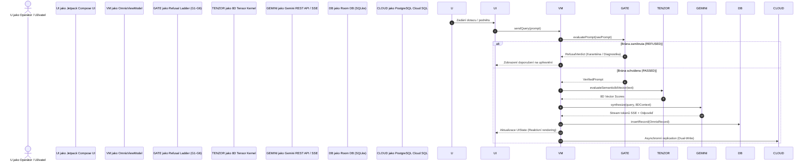
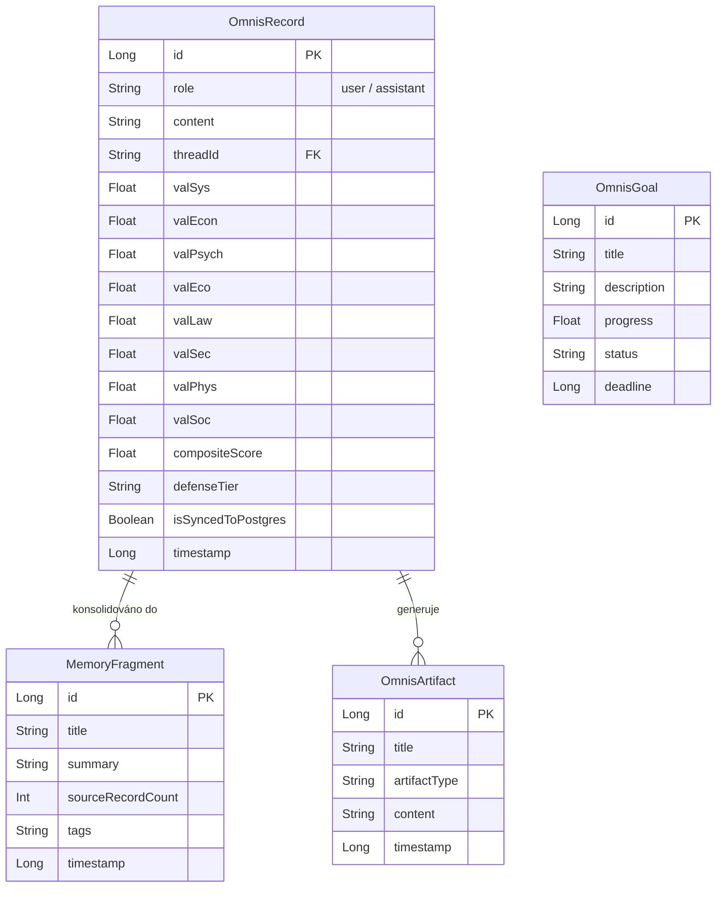

# O.M.N.I.S. (Agentic Knowledge Graph & Invariant Inference Engine — AKGE-8D) — Technická a Architektonická Analýza

Verze systému: 4.2 (Production Ready, Q1 2026)  
Cílová platforma: Android OS (API 26–36) | Jetpack Compose M3 | Room SQLite | Google Cloud SQL PostgreSQL | Python FastAPI CSR Graph  
Základní balíček: `com.example` | Runtime Application ID: `com.aistudio.omnis.quantum.v2026`

---

## 1. Globální Architektura Systému

Aplikace O.M.N.I.S. je navržena podle principů **Clean Architecture** a **Unidirectional Data Flow (UDF)** s reaktivním stavem postaveným na Kotlin Coroutines a Kotlin `StateFlow`. Systém fyzicky a logicky odděluje klientské rozhraní pro běžné uživatele (`UserNavigationLayout`) od správcovského a diagnostického scaffoldingu (`AdminNavigationLayout`).

### Sekvenční Diagram Zpracování Dotazu (UDF Pipeline)



### Blokové ASCII Schéma Systémových Vrstev

```
┌────────────────────────────────────────────────────────────────────────┐
│                   PREZENTAČNÍ VRSTVA (Jetpack Compose M3)              │
│                                                                        │
│  ┌──────────────────────────────┐    ┌──────────────────────────────┐  │
│  │     UserNavigationLayout     │    │     AdminNavigationLayout    │  │
│  │  (Chat, Kokpit, Cíle, Nexus) │    │  (Hub, PromptLab, Audit, DB) │  │
│  └──────────────┬───────────────┘    └──────────────┬───────────────┘  │
│                 │                                   │                  │
│                 └─────────────────┬─────────────────┘                  │
│                                   ▼                                    │
│                    OmnisViewModel / UIStateFlows                       │
│    (aktivní vlákno, streaming, filtry, 8D matice, telemetrie)          │
└───────────────────────────────────┬────────────────────────────────────┘
                                    │
                                    ▼
┌────────────────────────────────────────────────────────────────────────┐
│             KOGNITIVNÍ, BEZPEČNOSTNÍ A AUDITNÍ ENGINE                  │
│                                                                        │
│  ┌──────────────────┐  ┌──────────────────┐  ┌──────────────────────┐  │
│  │ GeminiApiService │  │ Refusal Ladder   │  │ Defense Tier Auditor │  │
│  │ (REST / SSE)     │  │ Gatekeeper (G1-G6│  │ (Bezpečnostní štít)  │  │
│  └──────────────────┘  └──────────────────┘  └──────────────────────┘  │
│  ┌──────────────────┐  ┌──────────────────┐  ┌──────────────────────┐  │
│  │ 8D Vector Engine │  │ Causal Simulator │  │ Dialectic Engine     │  │
│  │ (Multidoménovost)│  │ (Kontrafaktuály) │  │ (Teze/Antiteze/Synt) │  │
│  └──────────────────┘  └──────────────────┘  └──────────────────────┘  │
│  ┌──────────────────┐  ┌──────────────────┐  ┌──────────────────────┐  │
│  │ CircuitBreaker   │  │ CSR Graph Engine │  │ ZK Audit Ledger      │  │
│  │ (Pojistka výpadku│  │ (Topologie CSR)  │  │ (Kryptografické ZK)  │  │
│  └──────────────────┘  └──────────────────┘  └──────────────────────┘  │
└───────────────────────────────────┬────────────────────────────────────┘
                                    │
                                    ▼
┌────────────────────────────────────────────────────────────────────────┐
│             DATOVÁ PERSISTENCE A SYNCHRONIZAČNÍ VRSTVA                 │
│                                                                        │
│  ┌──────────────────────────────────────────────────────────────────┐  │
│  │                  OmnisDatabase (Room SQLite v12)                 │  │
│  │  Tabulky: omnis_messages, omnis_memory_fragments, omnis_goals,   │  │
│  │           omnis_artifacts, omnis_telemetry                       │  │
│  └──────────────────────────────┬───────────────────────────────────┘  │
│                                 │ Asynchronní Sync Pipeline            │
│                                 ▼                                      │
│  ┌──────────────────────────────────────────────────────────────────┐  │
│  │            CloudSqlSyncManager / PostgreSQL (pgvector)           │  │
│  │            Bezpečný vzdálený cloudový sklad & záloha             │  │
│  └──────────────────────────────────────────────────────────────────┘  │
└────────────────────────────────────────────────────────────────────────┘
```

---

## 2. Datový Model a Entity Relationship (ER) Diagram



---

## 3. Moduly, Třídy a Funkční Návaznosti

### 3.1 Modul Kognitivního Jádra a AI Komunikace (`com.example.ai`, `com.example.api`)

1. **`GeminiApiService`**: Zajišťuje síťovou komunikaci s REST API modelů Google Gemini (`gemini-2.5-flash` / `gemini-2.5-pro`) a reaktivní proudové vysílání tokenů přes Server-Sent Events (SSE).
2. **`RefusalLadderGatekeeper`**: Provádí 6-úrovňovou verifikaci (G1 až G6) garantující nulovou halucinaci a ověření normativních standardů (ISO/IEC, EU AI Act, NIS2).
3. **`CircuitBreaker` (`com.example.defense`)**: Softwarový jistič chránící aplikaci před kaskádovým selháním při výpadku sítě nebo vyčerpání kvóty API.

### 3.2 Modul 8D Vektorové Matice a Analytiky (`com.example.data`, `com.example.ui.octagon`)
Systém analyzuje každý podnět v osmirozměrném vektorovém prostoru `[SYS, ECON, PSYCH, ECO, LAW, SEC, PHYS, SOC]` s výpočtem 28-párového tenzoru vzájemných vazeb.

---

## 4. Prezentační Úrovně a RBAC
- **`STANDARD_USER`**: Skryté technické logy a tenzory, čistý uživatelský chat, srozumitelná lidská řeč.
- **`ADMIN_OPERATOR`**: Surové 8D vektory, CSR topologie, telemetrie RAM/latencí, ZK-SNARK kryptografický otisk a oprávnění `MODIFY_SYSTEM_STATE`.
